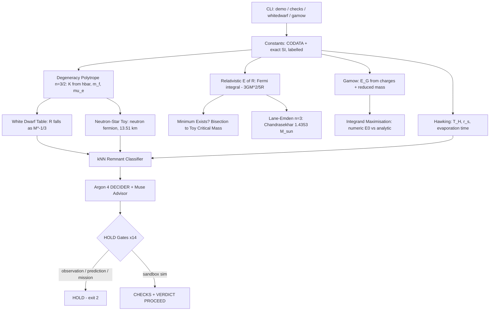
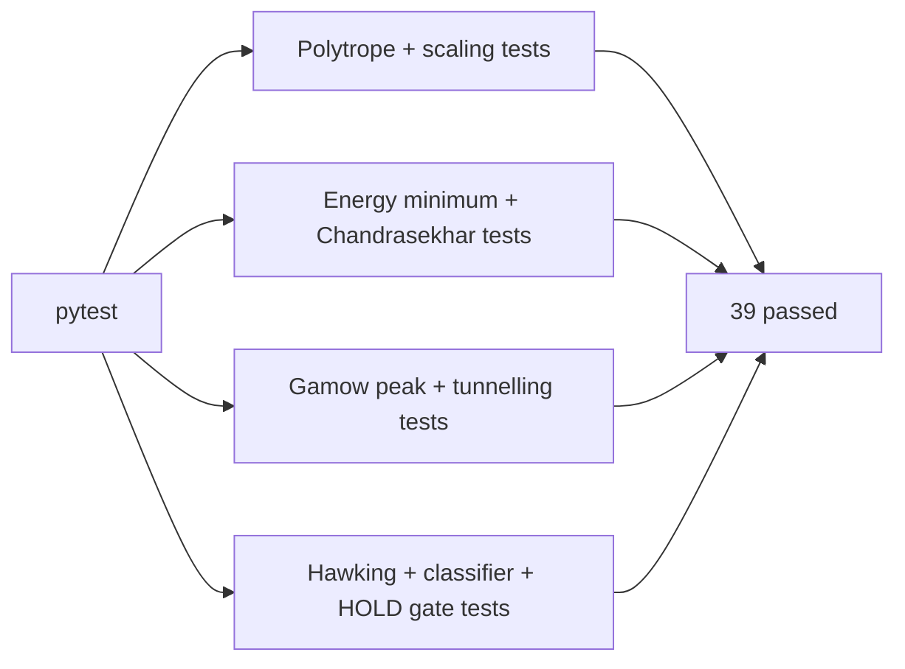
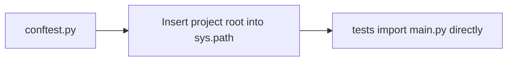
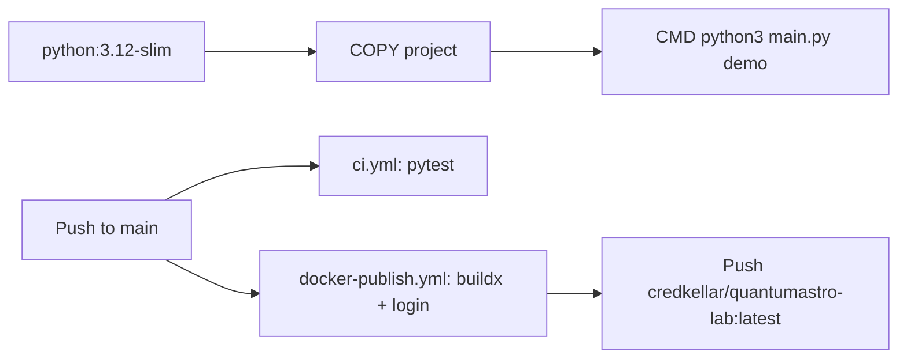

# QuantumAstro-Lab 🌌⚛️

**Quantum Astrophysics Lab** — by Darion Kellar

QuantumAstro-Lab is an **educational quantum astrophysics lab** in ONE pure-Python file. It computes the textbook physics of stellar remnants and stellar cores from labelled constants — nothing fitted, nothing observed, everything derived in the open:

- **White dwarfs** held up by electron degeneracy: a nonrelativistic n = 3/2 polytrope whose radius *falls* as mass grows, `R ∝ M^(−1/3)` — at 1.0 M_sun the lab gets **8,771.9 km**, about the size of a planet, from `ħ`, `G`, `m_e` and the mass alone. 🌟
- **The Chandrasekhar limit**: the exact relativistic Fermi-gas energy `E(R) = E_kin − 3GM²/(5R)` has a minimum at 1.0 M_sun (R* = 5,010.3 km) and **no minimum at all** at 3.0 M_sun. The uniform-density toy's critical mass (1.7214 M_sun, found by bisection *and* by the ultra-relativistic coefficient equality — two routes, one number) is printed next to the real Lane–Emden n = 3 answer computed from the constants: **1.4353 M_sun**. 🔬
- **Fusion tunnelling**: the Maxwell–Boltzmann factor times the WKB probability `exp(−√(E_G/E))`, with the p–p Gamow energy `E_G` = **493.13 keV** computed from the charges and reduced mass. The product peaks at **E0 = 5.9058 keV** at the labelled solar-core temperature — the lab's own numerical maximisation finds 5.9031 keV. ☀️
- **Neutron stars**: the same degeneracy machinery with the neutron as the fermion collapses the radius scale to **13.51 km** at 1.4 M_sun — a labelled order-of-magnitude toy with GR ignored, stated everywhere. 🌠
- **Hawking temperature**: `T_H = ħc³/(8πGMk_B)` = **6.170e-08 K** for a solar-mass black hole, with the Schwarzschild radius (2.9533 km) and the evaporation timescale (2.096e67 yr) computed beside it. 🕳️

Honest scope, stated up front: every constant is a labelled CODATA / exact-SI value, every mass and temperature is a **labelled teaching value**, and no output is fitted to, measured from, or predicted about any real star. Every observational / mission / prediction claim sits behind a permanent HOLD gate (14 total). 🔒

[](https://github.com/kimanicollier44-cmyk/QuantumAstro-Lab/actions/workflows/ci.yml)
[](https://github.com/kimanicollier44-cmyk/QuantumAstro-Lab/actions/workflows/docker-publish.yml)

> ℹ️ These are the **live** workflow badges for this repo. They activate as soon as the `ci.yml` and `docker-publish.yml` files from the paste pack are pasted into `.github/workflows/` — until then they have nothing to report yet.

## 🧰 Tech Stack Badges & Full Architecture Tech Stack

### 💻 Core Programming Languages & Core Systems


- 🐍 Python 3.12, pure standard library (`math`, `hashlib`, `json`, `sys`) — zero dependencies, zero network, deterministic (double-run byte-identical)
- 🌟 Degeneracy core: Fermi-gas pressure `P = (3π²)^(2/3) ħ²/(5 m_f) · n^(5/3)`, the n = 3/2 and n = 3 Lane–Emden mass–radius relations, and the closed-form relativistic Fermi kinetic-energy integral — every formula asserted against an analytic value or an independent route in CHECKS
- 🔥 Fusion core: Gamow energy from charges + reduced mass, WKB tunnelling factor, Maxwell–Boltzmann factor, product integrand maximised numerically on a grid + golden-section refine
- 🧠 TinyML kNN remnant classifier (from scratch, stdlib): main-sequence-supported / white-dwarf / neutron-star / black-hole from mass + radius, labels from the lab's own computed boundaries
- 🪑 Council seats: Gemini Argon 4 DECIDER (names-only, tighten-only) + Muse advisor (never overrides HOLD) + Google Flow plan-only (rendered = False, live = 0)

### ⛓️ Web3 & Infrastructure

- 🚫 **Not applicable — honestly.** No blockchain, no Web3, no tokens: the "infrastructure" in this lab is a set of textbook formulas and one offline file. No fake badges here.

### ⚙️ Platform Support & Hardware Architecture


- 🖥️ Pure Python — runs anywhere Python 3.12+ runs (Linux, macOS, Windows), plus the `python:3.12-slim` Docker image
- 🔒 No telescope, probe, or instrument is controlled, ever: observational and mission uses are permanent HOLD gates (see the gate table below)

### ⚡ Low-Level Infrastructure & Performance

- 🚫 **No low-level code — honestly.** No C, no C++, no GPU, no compiled extensions: this is one interpreted Python file on purpose, so every number can be read, checked, and diffed. Performance here means honest algorithms — golden-section minimisation of E(R), a bisection on the minimum-existence predicate, and a grid + golden maximisation of the Gamow integrand — all deterministic and byte-identical between runs.

### 🛠️ DevOps & Build Tools


- 🐳 Docker (`python:3.12-slim`), GitHub Actions CI + Docker Publish (delivered in the paste pack)
- 🎯 Target image: `credkellar/quantumastro-lab:latest`
- 🧪 Tests: `pytest` (39 tests) + the built-in CHECKS suite (50 checks) in `main.py`

### ☁️ Cloud Providers

- 🚫 **None — honestly.** No cloud provider is used or needed: the lab runs fully offline on your own machine or in a local Docker container. Docker Hub appears only as the registry the publish workflow pushes the image to.

## What this does?

1. 🌟 **White-dwarf degeneracy — heavier means smaller** — the nonrelativistic Fermi pressure becomes an n = 3/2 polytrope with `K` computed from `ħ`, `m_e`, and μ_e = 2 (carbon/oxygen: 2 nucleons per electron). The table falls from **11,905.3 km at 0.4 M_sun to 7,841.2 km at 1.4 M_sun**, exactly on the `M^(−1/3)` scaling — the checks assert `R(2M)/R(M) = 2^(−1/3)` to 1e-12, not approximately.
2. ⚖️ **The relativistic turn-over** — the kinetic energy switches to the exact relativistic Fermi integral (closed form, in terms of `x = p_F/(m_e c)`), and the total energy `E(R) = E_kin − 3GM²/(5R)` is minimised by scan + golden-section: at 1.0 M_sun a true minimum at **R* = 5,010.3 km, E_min = −1.309e43 J**; at 3.0 M_sun the energy falls all the way in — **no equilibrium at any radius**.
3. 🎯 **Two critical masses, both printed** — bisecting on "does the minimum still exist?" gives the uniform-density toy's critical mass **1.7214 M_sun**, and the ultra-relativistic coefficient equality gives **1.7214 M_sun** analytically: two independent routes landing on the same number. The textbook Lane–Emden n = 3 value, computed from `(ħc/G)^(3/2)/(μ_e m_H)²` with the standard prefactor (3.098, derived in the code), is **1.4353 M_sun** — the toy overshoots because a real star is centrally concentrated, and the lab says so.
4. ☀️ **The Gamow peak — fusion burns in the tail** — for p–p, `E_G = 2μc²(πα)²` = **493.13 keV** from the charges and the reduced mass `m_p/2`. At the labelled solar-core temperature 1.5e7 K (`kT` = 1.2926 keV), the product of the falling Boltzmann factor and the rising tunnelling probability peaks at **E0 = 5.9058 keV** analytically — and the lab's own grid + golden-section maximisation of the integrand finds **5.9031 keV**, agreeing to 0.05%.
5. 🚪 **Through the barrier, not over it** — the peak sits at `E0/kT` = **4.57**, and the peak suppression `exp(−3E0/kT)` = **1.115e-06** is printed: roughly one collision in a million rides the peak. The tunnelling probability at thermal energies is astronomically small, and the lab shows the number instead of hiding it.
6. 🌠 **Neutron-star toy — same machinery, heavier fermion** — swap the electron for the neutron (pressure *and* mass from the same particle) and the 1.4 M_sun radius collapses from 7,841.2 km to **13.51 km**, with central density 1.615e18 kg/m³. Labelled for what it is: an order-of-magnitude degeneracy scaling — GR ignored, no nuclear interactions, no real equation of state.
7. 🕳️ **Hawking temperature** — `T_H = ħc³/(8πGMk_B)` computed for labelled masses: **6.170e-08 K** at 1 M_sun (colder than the cosmic microwave background — a real hole today absorbs more than it radiates), 6.170e-09 K at 10 M_sun, with `T ∝ 1/M` asserted exactly in the checks.
8. ⏳ **Evaporation timescale** — `t = 5120πG²M³/(ħc⁴)` gives **2.096e67 years** for a solar-mass hole, and the `M³` scaling is asserted (`t(2M)/t(M) = 8`): the formula is the content, not a prediction about any real object.
9. 🏷️ **Remnant classifier** — a from-scratch kNN over (mass, radius) whose training grid is labelled by the lab's own policy, built from its own computed boundaries (1.5 × Schwarzschild radius → black-hole; ≤ 100 km → neutron-star; ≤ 30,000 km → white-dwarf; else main-sequence-supported). The Sun-like point, both lab white dwarfs, the lab neutron star, and a point inside the Schwarzschild scale all classify correctly — on toy points, never on real observed objects (a HOLD gate).
10. 🔒 **Seats, gates, checks** — Gemini Argon 4 DECIDER (sha256 trace, tighten-only), Muse advisor, Google Flow plan-only, 14 permanent HOLD gates, and a built-in CHECKS suite (50 checks) that re-derives every headline number above before the demo is allowed to print PROCEED.

## 🗺️ How it works — diagram per script

### `main.py` — the whole lab



### `tests/test_main.py` — verification



### `conftest.py` — test path setup



### `Dockerfile` + CI flow — container & publish



## Why is this cool?

1. 🌟 The white-dwarf table *is* the physics lesson: add mass and the star **shrinks** — 11,905.3 km at 0.4 M_sun down to 7,841.2 km at 1.4 M_sun — because degeneracy pressure stiffens as you squeeze it, until it doesn't.
2. 🎯 The Chandrasekhar mass is **computed, not quoted**: `(ħc/G)^(3/2)/(μ_e m_H)²` times a prefactor the code derives from the n = 3 Lane–Emden solution lands on 1.4353 M_sun — the most famous number in stellar astrophysics, out of pure constants.
3. ⚖️ The energy minimum **vanishing** is shown, not asserted: `E(R)` has a floor at 1.0 M_sun and no floor at 3.0 M_sun, and the bisection watches it disappear at 1.7214 M_sun in the toy.
4. 🔍 Two routes, one number: the toy's critical mass comes out of a numerical bisection *and* an analytic coefficient equality, agreeing to four decimals — the lab cross-checks itself the way a physicist would.
5. ☀️ The Gamow peak is found twice too: the analytic `(E_G (kT)²/4)^(1/3)` says 5.9058 keV, and maximising the actual product integrand says 5.9031 keV. Fusion's strangest fact — stars burn at energies far above `kT`, through a barrier — becomes arithmetic.
6. 🌠 One fermion swap collapses a star: electron → neutron takes the same 1.4 M_sun from 7,841.2 km to 13.51 km, a factor of ~580, with nothing changed but the particle in the same formulas.
7. 🕳️ A solar-mass black hole is colder than deep space: 6.170e-08 K against the 2.7 K cosmic background, and its evaporation time (2.096e67 yr) dwarfs the age of the universe by 57 orders of magnitude — both from one line of constants.
8. 🧮 Exact scalings are asserted, not eyeballed: `R ∝ M^(−1/3)` to 1e-12, `E0 ∝ T^(2/3)` to 1e-9, `t_evap ∝ M³` to 1e-9, `T_H ∝ 1/M` to 1e-12. If the physics drifts, the checks scream.
9. 🙌 The toy's failure is printed in the headline section: uniform density overshoots the Chandrasekhar mass (1.72 vs 1.44), and the README, the demo, and the report all say why. Honesty as a feature.
10. 🎯 Deterministic end to end: run it twice, get byte-identical output — a stellar astrophysics lab you can diff.

## What problems this solves?

1. ❌ **Problem:** "White dwarfs shrink as they gain mass" is usually stated as a fun fact with no derivation. ✅ **Solution:** The polytrope constant `K` is built from `ħ`, `m_e`, and μ_e, the Lane–Emden relation does the rest, and the `M^(−1/3)` scaling is asserted to 1e-12.
2. ❌ **Problem:** The Chandrasekhar limit gets quoted as 1.44 M_sun like a phone number. ✅ **Solution:** It is computed from `(ħc/G)^(3/2)/(μ_e m_H)²` with the n = 3 prefactor derived in the code — and the energy-minimum picture shows *why* a limit exists at all.
3. ❌ **Problem:** Simple energy arguments quietly give the wrong critical mass (~1.7). ✅ **Solution:** The lab prints the toy value AND the Lane–Emden value side by side, labelled, with the reason for the difference (central concentration) stated.
4. ❌ **Problem:** Fusion is taught as "hot enough to overcome the Coulomb barrier" — which is false; the Sun's core is nowhere near hot enough. ✅ **Solution:** The Gamow integrand shows the real story: tunnelling from the Boltzmann tail, peak at 4.57 × kT, suppression 1.115e-06 printed.
5. ❌ **Problem:** Gamow-peak formulas are usually just asserted. ✅ **Solution:** The lab maximises the product integrand numerically (grid + golden-section) and checks it against the analytic `E0` — 5.9031 vs 5.9058 keV.
6. ❌ **Problem:** Neutron-star radii appear from nowhere in pop science ("about 10 km, trust us"). ✅ **Solution:** The same polytrope machinery with the neutron swapped in produces 13.51 km, with the toy's limits (no GR, no EOS) printed next to it.
7. ❌ **Problem:** Hawking temperature is invoked constantly and computed almost never. ✅ **Solution:** One formula, exact constants, three labelled masses — plus the Schwarzschild radius and evaporation time so the scale is felt, not just named.
8. ❌ **Problem:** Remnant classification charts hide their boundaries. ✅ **Solution:** The kNN's labels come from a policy function in the code whose boundaries are the lab's own computed scales — read the policy, get the labels.
9. ❌ **Problem:** Textbook constants get laundered into "measurements" by careless tools. ✅ **Solution:** Every constant is labelled CODATA / exact-SI in the source, and `textbook_value_as_measurement_claim` is a permanent HOLD gate.
10. ❌ **Problem:** Simulation tools quietly imply observational or mission relevance. ✅ **Solution:** 14 named HOLD gates return exit code 2 for every observation, prediction, classification-of-real-objects, mission, or reactor claim, forever.

## How to install this?

1. 📋 Clone or download this project folder.
2. 🐍 Make sure Python 3.12+ is installed: `python3 --version`
3. ▶️ Run the full demo + checks (no arguments needed):

```bash
python3 main.py
```

4. 🧪 Run the test suite:

```bash
pip install pytest
python3 -m pytest -q
```

5. 🎛️ Try the other commands:

```bash
python3 main.py checks       # 50 built-in checks
python3 main.py whitedwarf   # degeneracy polytrope table (JSON)
python3 main.py chandrasekhar # E(R) minima + both critical masses (JSON)
python3 main.py gamow        # Gamow peak report (JSON)
python3 main.py neutronstar  # neutron-star toy report (JSON)
python3 main.py hawking      # Hawking temperature table (JSON)
python3 main.py classify     # kNN remnant classifier report
python3 main.py brains       # Argon 4 + Muse + Flow seats
python3 main.py holds        # list all 14 HOLD gates
python3 main.py hold-demo    # exits 2 - gated actions stay HOLD
```

6. 🐳 Or run it in Docker:

```bash
docker build -t credkellar/quantumastro-lab:latest .
docker run --rm credkellar/quantumastro-lab:latest
```

## Requirements

- 🐍 Python 3.12 or newer
- 📦 Dependencies: **none** (standard library only)
- 🌐 Network: **none** — fully offline
- 🧪 For tests only: `pytest`
- 🐳 Optional: Docker

## FULL project structure tree

```text
quantumastro-lab/
├── main.py                  # the whole lab: degeneracy polytropes, relativistic E(R), Chandrasekhar mass, Gamow peak, neutron-star toy, Hawking radiation, classifier, seats, HOLD gates
├── conftest.py              # puts the project root on sys.path for tests
├── tests/
│   └── test_main.py         # 39 pytest tests: polytrope, energy minimum, Gamow, Hawking, classifier, gates, determinism
├── assets/
│   └── cover.png            # README cover image (2736 x 912)
├── Dockerfile               # python:3.12-slim, runs the demo
├── .gitignore               # __pycache__/, .pytest_cache/, *.pyc
└── README.md                # this file
```

> 📦 Delivered separately as paste packs (not in this tree): `.github/workflows/ci.yml` + `docker-publish.yml`, and the Docker Hub pack (100-char description, 350-char About, overview, categories).

## 🔒 HOLD gates — all 14, permanent

| # | Gate | What stays held |
|---|------|-----------------|
| 1 | `observational_data_claim` | No claiming lab numbers are observations of any real star or object |
| 2 | `real_star_prediction_claim` | No predicting a real star's fate, mass, radius, or lifetime |
| 3 | `mission_design_claim` | No mission, probe, or spacecraft design use of these toy models |
| 4 | `telescope_observation_claim` | No claiming any real object is detectable or visible from these numbers |
| 5 | `gravitational_wave_claim` | No gravitational-wave event, merger, or detection predictions |
| 6 | `supernova_prediction_claim` | No supernova timing, type, or progenitor predictions for real stars |
| 7 | `real_object_classification_claim` | No classifying a real observed object as white dwarf / neutron star / black hole from this lab |
| 8 | `fusion_reactor_claim` | The Gamow math is stellar teaching material, not a fusion reactor design |
| 9 | `weapons_claim` | No weapons use of fusion, tunnelling, or degeneracy physics, ever |
| 10 | `habitability_claim` | No habitability or life claims about real stars or planets |
| 11 | `navigation_claim` | No spacecraft navigation or trajectory use |
| 12 | `investment_claim` | No investment or space-industry claims from a teaching model |
| 13 | `astrology_claim` | No astrology; this lab is physics, not fortune-telling |
| 14 | `textbook_value_as_measurement_claim` | Textbook constants and polytrope outputs must never be presented as measurements |

🧑‍⚖️ **Council seats:** Gemini Argon 4 Extended Thinking — DECIDER (names-only, tighten-only, MAP → MODEL → STRESS → DECIDE, sha256 trace, `can_override_hold = False`) · Muse — advisor (`can_override_hold = False`) · Google Flow — plan-only (`rendered = False`, `live = 0`).

✅ **Verification:** pytest **39 passed** (project + clean copy) · built-in CHECKS **50/50** · double-run output **byte-identical** · `hold-demo` exits **2** · `main.py` **837 lines**, pure stdlib, zero network.

## 🧒 5th-grade English section

Imagine squeezing a star until it stops shrinking. What pushes back? Not heat — a rule of the tiny world: **two electrons refuse to sit in the same spot in the same way**. When a star runs out of fuel and collapses, that refusal is the only thing holding it up. That is a **white dwarf**: a star squeezed down to the size of a planet. 🌟

- The strangest part: the **heavier** the white dwarf, the **smaller** it gets. Add more weight and it squeezes tighter, like a spring that gets shorter the more you load it. This lab does that math and watches it happen. 📏
- But electrons can only refuse so hard. Push past about **1.44 suns** of mass and the pushing-back stops working — the star falls in on itself. A scientist named Chandrasekhar found that limit using only pencil, paper, and the constants of nature. This lab finds it too, two different ways. 🎯
- Deep inside the Sun, hydrogen bits are too weak to climb over the electric wall between them — so they **cheat and tunnel through it**, like a ghost walking through a door. It almost never works: about one try in a million is at the magic energy this lab computes. That trickle is exactly why the Sun burns slowly instead of exploding. ☀️
- If the falling star is heavier still, neutrons take over the refusing, and the whole star crushes down to the size of a **city** — a neutron star, so dense a teaspoon of it would weigh about a billion tons. 🌠
- And black holes, the end of the story, are not perfectly black: they glow, very, very faintly, at a temperature this lab computes — for a sun-sized one, far colder than deep space itself. 🕳️
- This project is a **pretend lab on a computer**. It does not look at real stars or predict anything about them. It helps you learn how the tiniest rules in physics decide the biggest things in the sky. 💻

---

MIT © 2026 Darion Kellar · QuantumAstro-Lab — educational simulation only 🌌
